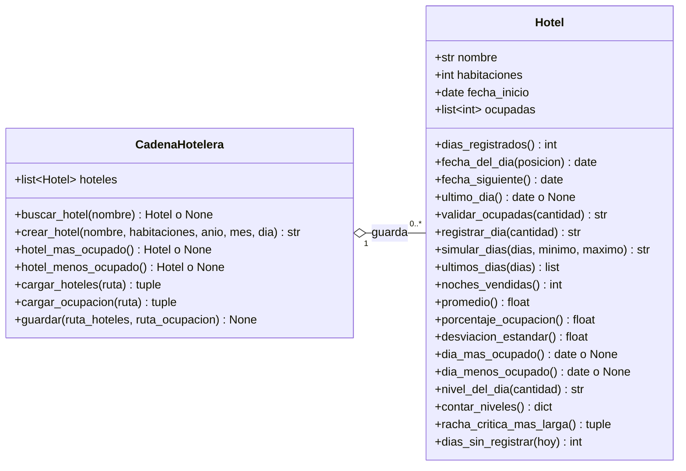
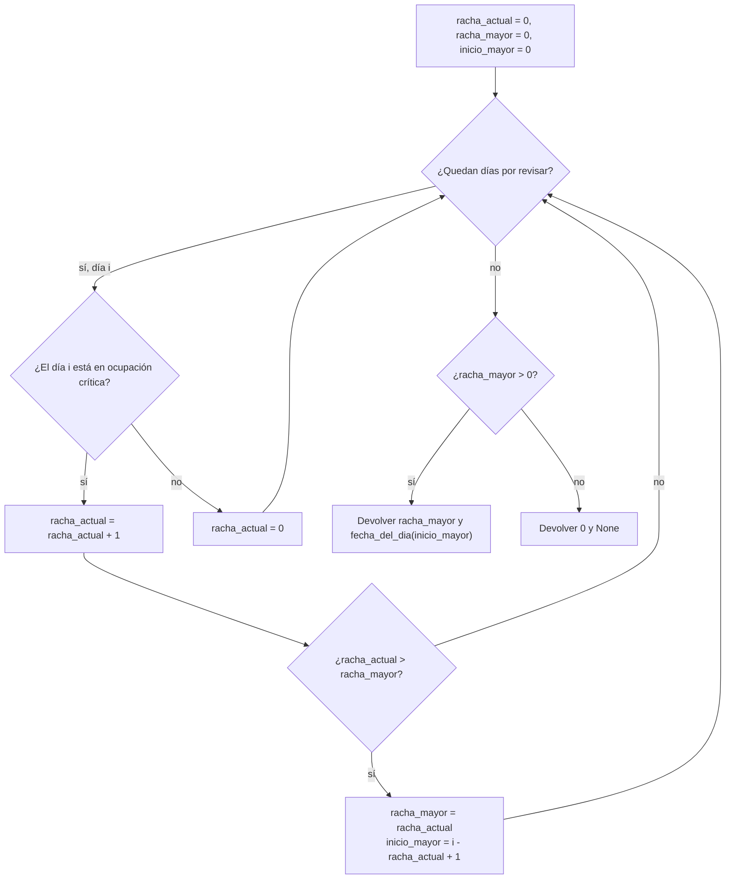
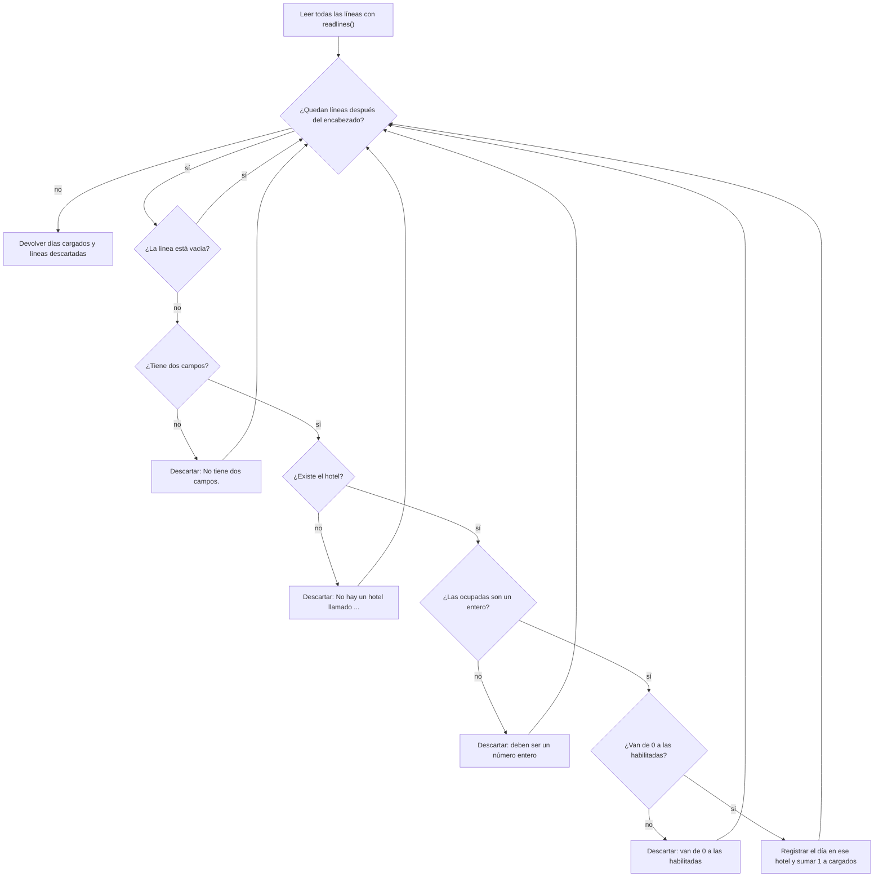

# Informe integral del trabajo realizado

Cadena Hotelera Sol Caribe, Alternativa A
Fundamentos de Programación, Universidad del Magdalena

Equipo: Miguel Vergara, Jhonatan Gonzales, Estefany Idarraga y Juan Montes.

## 1. Cómo trabajamos

Dividimos el programa en cuatro incrementos, que son los mismos milestones del repositorio. Cada incremento junta requisitos que dependen entre sí, y en cada uno pasamos por las cuatro actividades del ciclo: análisis, diseño, codificación y verificación. La especificación final de cada requisito está en el documento de análisis, y los casos con su salida esperada están en `casos_de_verificacion.md`.

Usamos Claude en todo el proceso, como piden los términos. El detalle de cada interacción está en el informe de uso de IA. Para contar bien de dónde salió el código: la primera versión completa del programa la generó la IA a partir del enunciado. Después la cambiamos tres veces. Primero la simplificamos al nivel del curso, porque usaba cosas que no vimos y era muy larga. Luego la ajustamos a las reglas de la clase: un solo `return` al final, sin `sum`, `max` ni `min`, y `try / except ValueError` en la interfaz. Por último corregimos lo que salió al probarla. Lo que se describe aquí es esa versión final.

| Incremento | Requisitos | Pasos y responsables | Issues |
|---|---|---|---|
| 1. Hoteles, registro y simulación | 1, 2, 3, 10 y 14 | Paso 1: Miguel. Paso 2: Jhonatan | #1, #2 |
| 2. Informe del hotel | 4 a 9 | Paso 3: Estefany. Paso 4: Juan | #3, #4 |
| 3. Comparación y carga de archivos | 11, 12 y 13 | Paso 5: Miguel. Paso 6: Jhonatan | #5, #6 |
| 4. Guardado y correcciones | 15 (agregado) y arreglos | Paso 7: Estefany. Paso 8: Juan | #7, #8, #9, #10, #11 |

## 2. Incremento 1: hoteles, registro y simulación

### Análisis

Lo primero fue entender bien el requisito 1. Las cuatro condiciones se revisan en orden y solo se muestra el mensaje de la primera que falla. Por eso, con 0 habitaciones y el 31 de noviembre, el programa avisa solo lo de las habitaciones. Notamos que -5 sí es un número entero, así que falla en la tercera condición y no en la segunda. Además, el programa lee los cinco datos primero y después los revisa.

En los requisitos 2 y 3 vimos una diferencia que hay que respetar. En el 2, si el dato está mal se vuelve a pedir para el mismo día. En el 3, si un dato está mal se vuelve al menú sin pedir los que faltan. Del requisito 10 sacamos la regla de comparar los nombres tal como están escritos, quitando solo los espacios de los lados.

Precisamos dos reglas que el enunciado no traía. La primera es el año de inicio entre 2000 y 2100, que salió de un problema que encontramos al probar (issue #9). La segunda es máximo 365 días por simulación, que salió de pensar qué pasaba si alguien metía millones de días por error.

### Diseño

Decidimos usar dos clases, `Hotel` y `CadenaHotelera`, en `business_logic.py`, y dejar todo lo que lee y escribe en pantalla en `user_interface.py`. La lógica no usa `input`, `print`, `system` ni `date.today()`.

La decisión más importante fue cómo guardar el registro de cada hotel. Como el registro no se salta días, basta una lista de enteros (`ocupadas`) con las habitaciones ocupadas de cada día. La fecha de un día no se guarda: se calcula como la fecha de inicio más su posición en la lista. Así, el día siguiente es simplemente la fecha de inicio más `len(ocupadas)`.

Los métodos que revisan un dato devuelven un texto: `""` si el dato está bien, o el mensaje de error si no. Así el mismo mensaje sirve para el teclado y para el archivo. `crear_hotel` recibe los datos como texto y no como números ya convertidos, porque la carga de archivos (requisito 12) tiene que revisar las líneas en el mismo orden que el teclado y queríamos que las dos usaran el mismo método.

En la interfaz, las opciones 2 y 3 convierten lo tecleado con `int()` dentro de un `try / except ValueError`. La opción 2 repite la pregunta con un `while not registrado`. La opción 3 usa una bandera `seguir`: si un dato sale mal se pone en `False` y los bloques siguientes no se ejecutan. Como cada función tiene un solo `return` al final, no hay salidas en la mitad.

### Codificación

Miguel hizo el paso 1: las dos clases, `crear_hotel`, `buscar_hotel` y el menú. Jhonatan hizo el paso 2: `fecha_siguiente`, `validar_ocupadas`, `registrar_dia`, `simular_dias` y las opciones 2 y 3 de la interfaz.

### Verificación

Casos 1.1 a 1.16, 2.1 a 2.19 y 5.11 a 5.13 de `casos_de_verificacion.md`. Probamos cada mensaje del requisito 1, el año bisiesto, el cambio de año en el registro (30 de diciembre más 3 días da 2027-01-02), los extremos 0 y 20, y que en la simulación no se lean los datos que faltan después de un error. Todos dan la salida esperada.

## 3. Incremento 2: informe del hotel

### Análisis

Revisamos las fórmulas con los ejemplos del enunciado antes de programarlas. Rodadero tiene que dar 256 noches, 51.2 de promedio, 64.0 % y 19.78 de desviación. Taganga da 102 noches, 25.5, 63.75 % y 8.29. La desviación de Taganga la hicimos a mano, como viene en el enunciado: los cuadrados suman 275, eso entre 4 da 68.75 y la raíz es 8.29.

En los empates del día de más y de menos, y de la racha, se muestra el primero. En el requisito 9 entendimos que "al día" también cubre el caso en que se simularon días hasta después de hoy.

### Diseño

Un método por indicador, todos en `Hotel`. Como no podemos usar `sum`, `max` ni `min`, las noches y la desviación se calculan con acumuladores, y el día de más y de menos se buscan recorriendo la lista con `range(len(...))`. Comparamos con `>` y `<` estrictos para que en un empate se quede el primero.

Cuando la lista está vacía, `promedio`, `porcentaje_ocupacion` y `desviacion_estandar` devuelven 0 para no dividir entre cero, y `ultimo_dia`, `dia_mas_ocupado` y `dia_menos_ocupado` devuelven `None`. La interfaz no llega a mostrarlos, porque con un hotel sin días el informe se corta antes.

Para la racha usamos tres variables: la racha actual, la mayor y la posición donde empezó la mayor (el algoritmo está en la sección 6). Para los días sin registrar, en vez de calcular "hoy menos el último día, menos 1", calculamos "hoy menos el día siguiente". Da lo mismo y reutiliza `fecha_siguiente`. La fecha de hoy entra como parámetro, para que la lógica no dependa del reloj del computador.

### Codificación

Estefany hizo el paso 3: `noches_vendidas`, `promedio`, `porcentaje_ocupacion`, `desviacion_estandar`, `dia_mas_ocupado` y `dia_menos_ocupado`. Juan hizo el paso 4: `nivel_del_dia`, `contar_niveles`, `racha_critica_mas_larga`, `ultimo_dia`, `dias_sin_registrar` y la opción 4 de la interfaz.

### Verificación

Casos 3.1 a 3.18 y 4.6 a 4.8. Con los ejemplos de `hoteles_ejemplos.csv` probamos los empates (40, 80, 80, 16, 16), los límites de cada nivel (31, 32, 47, 48, 63, 64 de 80) y las dos rachas (20, 24, 60, 28, 16, 30, 70). Los casos del requisito 9 dependen de la fecha del computador, y en el documento de casos está la cuenta para cualquier fecha. Con ayuda de la IA también comparamos los indicadores contra un cálculo hecho aparte con miles de hoteles al azar, y coincidieron.

## 4. Incremento 3: comparación y carga de archivos

### Análisis

En el requisito 11 solo cuentan los hoteles con días, los porcentajes se comparan sin redondear y en un empate gana el que se creó o se cargó primero. En los requisitos 12 y 13 hay muchos detalles. La carga solo se hace con el programa vacío. La primera línea es el encabezado y las líneas vacías se saltan. Los espacios alrededor de los campos no cuentan. El número de línea que se muestra cuenta el encabezado como línea 1. Y si falla el archivo de ocupación, los hoteles quedan cargados sin días.

Precisamos qué pasa si la ruta es una carpeta o el archivo no está en UTF-8: el programa avisa que no se pudo leer el archivo, en vez de cerrarse.

### Diseño

`hotel_mas_ocupado` y `hotel_menos_ocupado` empiezan con `None`, se saltan los hoteles sin días y se quedan con el primero que encuentren mejor. Por el `>` estricto, en un empate se queda el que estaba antes en la lista.

Al diseñar la prueba del empate encontramos un problema con los decimales. Con la fórmula del enunciado tal cual, `promedio / habitaciones * 100`, Python da 48.0 para Sol Caribe Buritaca y 48.00000000000001 para Sol Caribe Don Diego, aunque los dos tienen exactamente 48 %. Así Don Diego ganaría el empate sin deberlo. Por eso `porcentaje_ocupacion` hace una sola división: `noches * 100 / (días * habitaciones)`. En `nivel_del_dia` dejamos la fórmula normal, porque revisamos los límites de 40, 60 y 80 % y ahí no falla (issue #10).

Las dos cargas leen el archivo con `readlines()` y recorren las líneas con `range(1, len(lineas))` para saltar el encabezado. Cada línea se parte con `split(";")`. `cargar_hoteles` reutiliza `crear_hotel`, así las causas salen en el mismo orden y con los mismos mensajes que con el teclado. Los errores de archivo los atrapa la interfaz: primero `FileNotFoundError` y después `OSError` y `UnicodeDecodeError`. `FileNotFoundError` va primero porque es un tipo de `OSError`, y si fuera después nunca se ejecutaría.

### Codificación

Miguel hizo el paso 5: `hotel_mas_ocupado`, `hotel_menos_ocupado` y la opción 5. Jhonatan hizo el paso 6: `cargar_hoteles`, `cargar_ocupacion` y la opción 6.

### Verificación

Casos 4.1 a 4.5 y 5.1 a 5.10. Usamos los CSV del enunciado, que tienen que dar 2 hoteles y 9 días con 5 líneas descartadas en cada archivo. También usamos los que armamos para el empate y uno con líneas en blanco y espacios de más (`hoteles_espacios.csv` y `ocupacion_espacios.csv`). El caso 5.9 falló la primera vez, pero el error estaba en la salida esperada del caso y no en el programa: la línea 4 del archivo de ocupación sí está mala, porque tiene un campo de más. Corregimos el caso.

## 5. Incremento 4: guardado y correcciones

### Análisis

Agregamos el requisito 15, guardar los datos al salir, para no perderlos al cerrar el programa. Decidimos que solo pregunte si hay hoteles y que guarde con el mismo formato que se carga, para poder recuperarlos con la opción 6.

### Diseño

`guardar` va en `CadenaHotelera` y escribe los dos archivos. La pregunta y los mensajes van en la interfaz, en `opcion_salir`. Los nombres de los archivos son fijos (`hoteles_guardados.csv` y `ocupacion_guardada.csv`) para no pedir más rutas.

### Codificación

Estefany hizo el paso 7, el guardado. Juan hizo el paso 8, las correcciones que salieron al probar:

- Atrapar `OverflowError` en `crear_fecha` y limitar el año de inicio entre 2000 y 2100 (issue #9).
- La división única en `porcentaje_ocupacion` (issue #10).
- En `cargar_ocupacion`, buscar el hotel solo después de revisar que la línea tenga dos campos. Además, el método `ultimos_dias`, para que la interfaz no tocara `hotel.ocupadas` con slicing negativo, que no vimos en clase (issue #11).

### Verificación

Casos 5.14 a 5.16: guardar, cerrar el programa, volver a abrirlo y cargar lo guardado. Después de las correcciones volvimos a correr los 77 casos y pasan todos. Con ayuda de la IA también hicimos miles de sesiones con entradas al azar, y el programa no se cerró en ninguna.

## 6. La solución final

### Archivos

```text
business_logic.py           clases Hotel y CadenaHotelera, reglas y cálculos
user_interface.py           menú, lectura de datos y mensajes en pantalla
casos_de_verificacion.md    los 77 casos con su salida esperada
datos/                      los CSV que usan los casos
```

Se ejecuta con `python user_interface.py` desde la carpeta del proyecto.

### Las clases



Además de las clases, `business_logic.py` tiene tres funciones sueltas que usan las dos clases. `es_entero(texto)` dice si un texto se puede convertir en entero. `crear_fecha(anio, mes, dia)` devuelve la fecha, o `None` si no es válida. `validar_dias_a_simular(dias)` revisa el número de días de la opción 3.

`user_interface.py` tiene una función por opción del menú (`opcion_crear_hotel`, `opcion_registrar_dia`, `opcion_simular_dias`, `opcion_ver_informe`, `opcion_comparar_hoteles`, `opcion_cargar_archivos` y `opcion_salir`). Además tiene `pedir_hotel`, que lee un nombre y busca el hotel, `limpiar_consola`, `mostrar_menu` y `main`, que tiene el ciclo del menú.

### Algoritmos de los métodos principales

#### `crear_hotel(nombre, habitaciones, anio, mes, dia)`

1. Quitar los espacios de los lados al nombre y calcular la fecha con `crear_fecha`.
2. Con una cadena de `if / elif`, revisar en orden: nombre vacío, nombre repetido, habitaciones que no son entero, habitaciones menores que 1, fecha `None` y año fuera de 2000 a 2100. Guardar en `mensaje` el texto de la primera condición que se cumpla.
3. Si ninguna se cumplió (`else`), crear el `Hotel` y agregarlo a la lista.
4. Devolver `mensaje`: `""` si se creó, o el error.

#### `buscar_hotel(nombre)`

1. Quitar los espacios de los lados al nombre. Empezar con `encontrado = None` e `i = 0`.
2. Mientras `i` sea menor que la cantidad de hoteles y `encontrado` siga en `None`: si el hotel `i` tiene ese nombre, guardarlo en `encontrado`. Sumar 1 a `i`.
3. Devolver `encontrado`.

El `while` con la condición `encontrado is None` para apenas encuentra el hotel, sin necesidad de un `return` dentro del ciclo.

#### `desviacion_estandar()`

1. Si no hay días, el resultado es 0.
2. Si hay, calcular el promedio y poner `suma = 0`.
3. Por cada cantidad de la lista, sumar a `suma` el valor de `(cantidad - promedio) ** 2`.
4. El resultado es `math.sqrt(suma / cantidad de días)`.

#### `dia_mas_ocupado()` (el de menos es igual con `<`)

1. Si no hay días, el resultado es `None`.
2. Si hay, empezar con `posicion_mayor = 0`.
3. Recorrer las posiciones con `range(len(ocupadas))`. Si el día `i` tiene más que el día `posicion_mayor`, cambiar `posicion_mayor = i`.
4. El resultado es `fecha_del_dia(posicion_mayor)`.

Como se compara con `>`, un día que empata con el mayor no lo reemplaza, y queda el primero.

#### `nivel_del_dia(cantidad)`

1. `porcentaje = cantidad / habitaciones * 100`.
2. Si es menor que 40, "crítica". Si no, y es menor que 60, "baja". Si no, y es menor que 80, "media". Si no, "alta".

El orden de los `elif` importa: cuando se llega a preguntar `< 60` ya se sabe que no es menor que 40.

#### `racha_critica_mas_larga()`



Así va con el ejemplo del enunciado, en un hotel de 80 habitaciones:

| i | Ocupadas | ¿Crítica? | racha_actual | racha_mayor | inicio_mayor |
|---|---|---|---|---|---|
| 0 | 20 | sí | 1 | 1 | 0 |
| 1 | 24 | sí | 2 | 2 | 0 |
| 2 | 60 | no | 0 | 2 | 0 |
| 3 | 28 | sí | 1 | 2 | 0 |
| 4 | 16 | sí | 2 | 2 (empata, no cambia) | 0 |
| 5 | 30 | sí | 3 | 3 | 5 - 3 + 1 = 3 |
| 6 | 70 | no | 0 | 3 | 3 |

La racha más larga tiene 3 días y empieza en la posición 3, que es el 2026-11-04.

#### `dias_sin_registrar(hoy)`

1. `faltan = (hoy - fecha_siguiente()).days`.
2. Si `faltan` es negativo, se deja en 0.
3. Devolver `faltan`.

Ejemplo: Rodadero tiene como día siguiente el 2026-11-06. El 2026-11-20 da 14 días.

#### `hotel_mas_ocupado()` (el menos ocupado es igual con `<`)

1. Empezar con `mayor = None`.
2. Por cada hotel con al menos un día: si `mayor` es `None`, o si el porcentaje del hotel es mayor que el de `mayor`, cambiar `mayor` por ese hotel.
3. Devolver `mayor`.

#### `cargar_ocupacion(ruta)`



`cargar_hoteles` es igual, pero revisa que haya cinco campos y después llama a `crear_hotel`. Cada línea descartada se guarda como "Línea N descartada: causa", donde N es `i + 1` porque la lista empieza en 0.

#### Opción 3 en la interfaz (`opcion_simular_dias`)

1. Buscar el hotel con `pedir_hotel`. Si no existe, no hacer nada más.
2. Poner `seguir = True`. Leer los días dentro de un `try`. Si `int()` falla, el mensaje es que deben ser un entero; si no, se revisan con `validar_dias_a_simular`. Si hay mensaje, mostrarlo y poner `seguir = False`.
3. Si `seguir` sigue en `True`, hacer lo mismo con el mínimo, usando `validar_ocupadas`.
4. Si `seguir` sigue en `True`, hacer lo mismo con el máximo.
5. Si `seguir` sigue en `True`, llamar a `simular_dias`, que revisa que el mínimo no sea mayor que el máximo. Si todo sale bien, mostrar cuántos días se simularon y la lista de `ultimos_dias`.

### Reglas que agregamos

El año de inicio entre 2000 y 2100, máximo 365 días por simulación, el aviso cuando un archivo no se puede leer, la pausa con Enter después de cada opción y el requisito 15 de guardar al salir. Están explicadas en el documento de análisis.

### Límites que conocemos

Si se guarda un hotel con punto y coma en el nombre, al volver a cargarlo esa línea se descarta por no tener cinco campos. Se arreglaría rechazando el punto y coma al crear el hotel.

Con habitaciones de más de unas 150 cifras, la desviación estándar falla con `OverflowError`, porque los decimales de Python no llegan a números tan grandes. Con números normales no pasa.

Si se oprime Ctrl+C mientras el programa espera un dato, termina con el mensaje de error de Python. No lo manejamos porque no hace parte de los requisitos.
